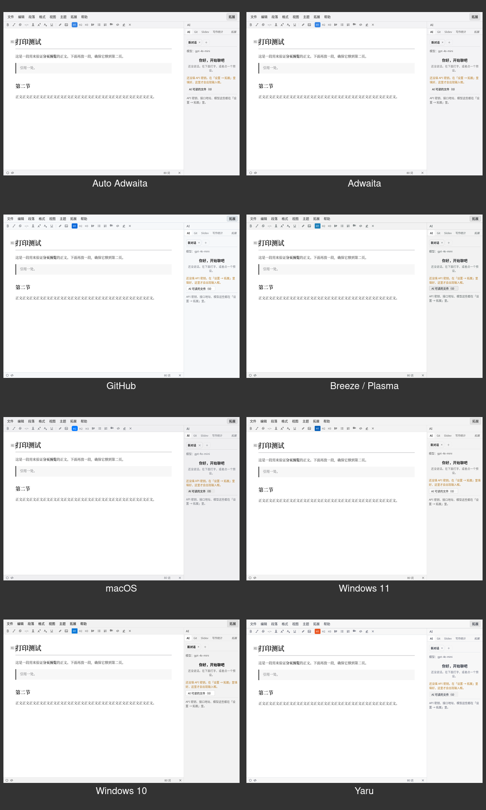
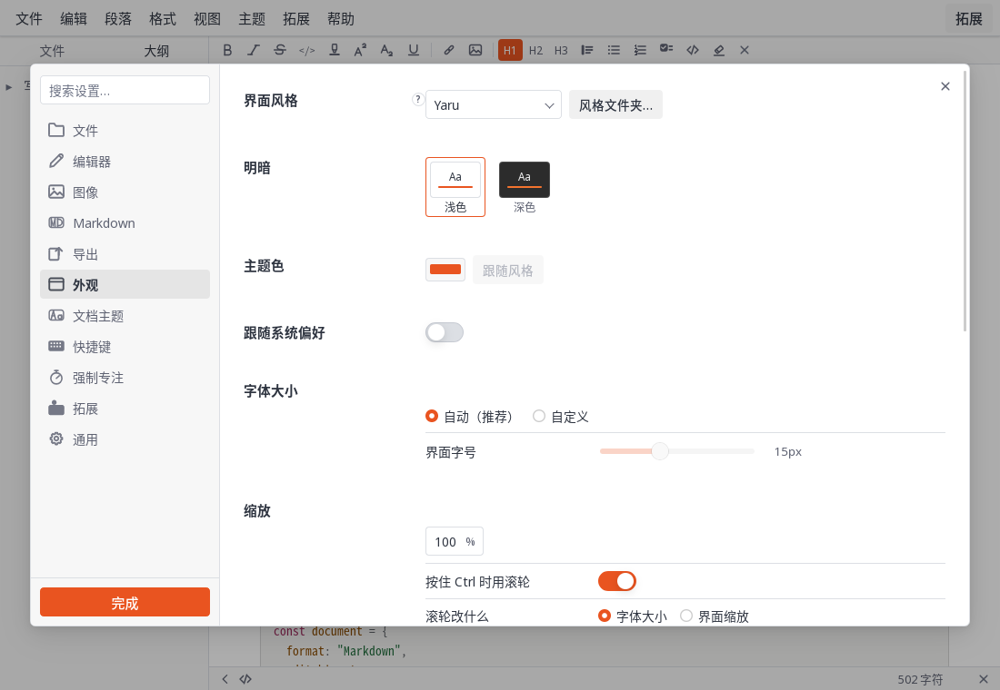
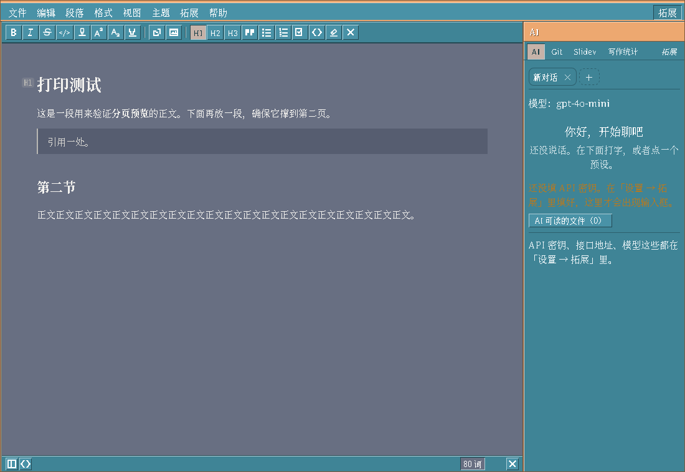
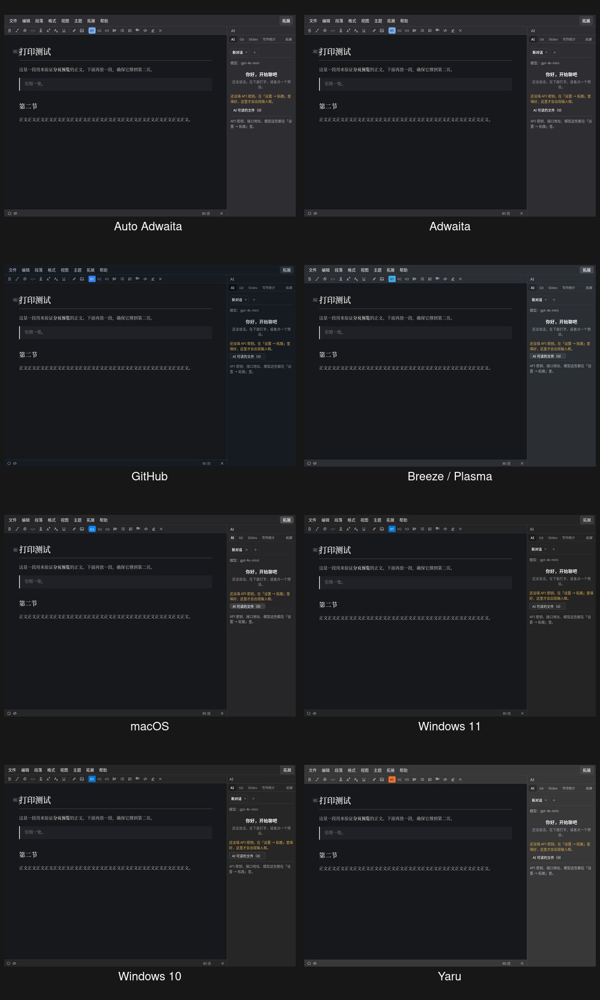

  

<h1 align="center">Nota Themes</h1>

Official interface themes and document themes for Nota.

  <a href="README.zh-CN.md">简体中文</a> ·
  <a href="https://github.com/Nota-MD/Nota/releases">Nota releases</a> ·
  <a href="https://nota-md.github.io/docs/">Documentation</a>

Nota keeps two visual axes independent:

- **Interface themes** change menus, sidebars, controls, icons and the interface font.
- **Document themes** change the writing surface and exported document styling.

## Interface themes

| Theme | Directory | CSS id |
|---|---|---|
| Adwaita | [`ui/adwaita`](ui/adwaita/) | `adwaita` |
| GitHub | [`ui/github`](ui/github/) | `ghub` |
| Breeze / Plasma | [`ui/breeze`](ui/breeze/) | `plasma` |
| macOS | [`ui/macos`](ui/macos/) | `macos` |
| Windows 11 | [`ui/windows11`](ui/windows11/) | `windows` |
| Windows 10 | [`ui/windows10`](ui/windows10/) | `windows10` |
| Yaru | [`ui/yaru`](ui/yaru/) | `yaru` |
| CDE-inspired | [`ui/cde`](ui/cde/) | `cde` |

### Install an interface theme

1. Open **Settings → Appearance → Styles folder…** in Nota.
2. Copy the theme CSS and all assets into that directory.
3. The CSS filename becomes the theme id. For example, `yaru.css` becomes `yaru`.
4. Select the theme under **Interface style**.

## Document themes

| Theme | File |
|---|---|
| Adwaita | [`document/adwaita/theme.css`](document/adwaita/theme.css) |
| Adwaita Dark | [`document/adwaita/dark.css`](document/adwaita/dark.css) |
| Minimal | [`document/minimal.css`](document/minimal.css) |
| Minimal Dark | [`document/dark/minimal.css`](document/dark/minimal.css) |
| LaTeX | [`document/latex.css`](document/latex.css) |
| LaTeX Dark | [`document/dark/latex.css`](document/dark/latex.css) |
| CDE-inspired | [`document/cde.css`](document/cde.css) |

### Install a document theme

1. Open **Settings → Document Themes → Open…**.
2. Copy the desired `.css` file into the theme directory.
3. Select it from the **Theme** menu.

## Downloads and updates

Theme packages are available under [Releases](https://github.com/Nota-MD/Nota-themes/releases).

Version, compatibility and download locations are also published in
[`latest.json`](latest.json). Consumers should ignore unknown fields.

## Contributing

Themes must use only CSS and declared assets, work without theme-specific code in the Nota
binary, include licenses for bundled assets, preserve keyboard focus, and be tested in light
and dark modes.

See the [theme tutorial](https://nota-md.github.io/docs/#/developer/themes/README) for the file
format and test checklist.

## License

Theme source is BSD-2-Clause unless a directory states otherwise. Third-party fonts and icons
retain their own licenses; see [`THIRD-PARTY.md`](THIRD-PARTY.md).
