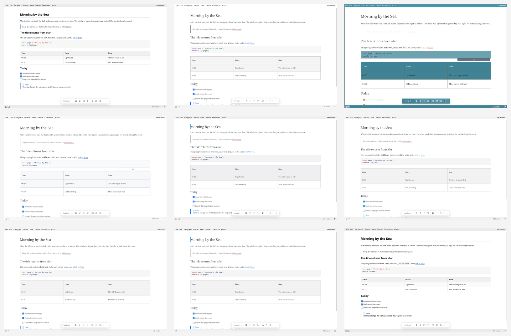
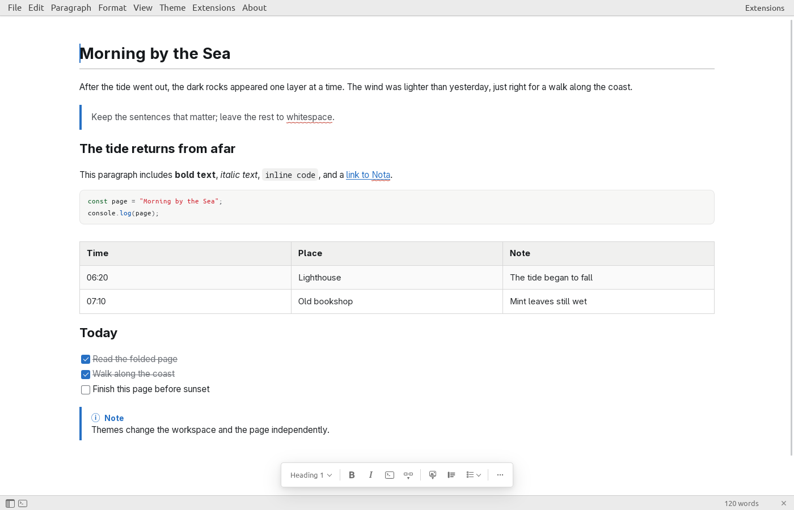
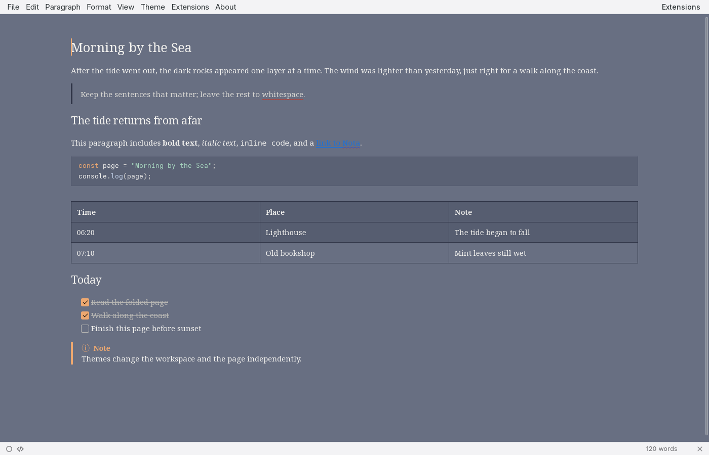
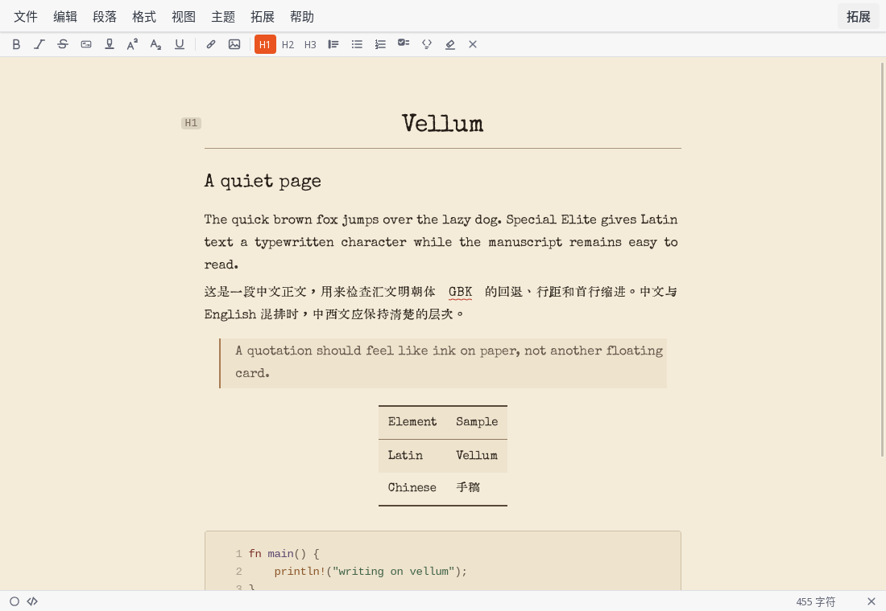
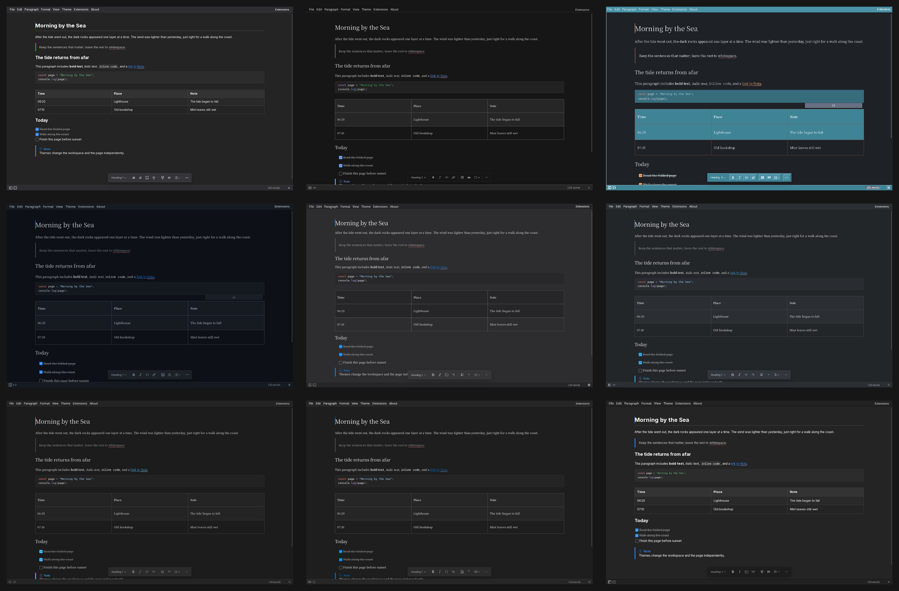

  

<h1 align="center">Nota Themes</h1>

Nota 官方界面主题与文档主题仓库。

  <a href="README.md">English</a> ·
  <a href="https://github.com/Nota-MD/Nota/releases">Nota 版本下载</a> ·
  <a href="https://nota-md.github.io/docs/">在线文档</a>

Nota 把外观分成两套独立主题：

- **界面主题**改变菜单、侧栏、按钮、图标和界面字体
- **文档主题**改变正文页面、标题、代码块和正文排版

## 界面主题

| 主题 | 目录 | CSS id |
|---|---|---|
| Adwaita | [`ui/adwaita`](ui/adwaita/) | `adwaita` |
| GitHub | [`ui/ghub`](ui/ghub/) | `ghub` |
| Breeze / Plasma | [`ui/plasma`](ui/plasma/) | `plasma` |
| macOS | [`ui/macos`](ui/macos/) | `macos` |
| Windows 11 | [`ui/windows`](ui/windows/) | `windows` |
| Windows 10 | [`ui/windows10`](ui/windows10/) | `windows10` |
| Yaru | [`ui/yaru`](ui/yaru/) | `yaru` |
| CDE-inspired | [`ui/cde`](ui/cde/) | `cde` |

CDE 界面主题有意只提供一套经典配色。Nota 的全局明暗设置仍可传入，但浅色和
深色会命中完全相同的一组 CDE 颜色。

### 安装界面主题

1. 打开 Nota 的 **设置 → 外观 → 风格文件夹…**
2. 将自包含主题目录（`<id>/theme.css` 与相关资源）复制进去
3. 目录名就是主题 id
4. 在“界面风格”中选择主题

## 文档主题

| 主题 | 文件 |
|---|---|
| Adwaita | [`document/adwaita/theme.css`](document/adwaita/theme.css) |
| Adwaita 深色 | [`document/adwaita-dark/theme.css`](document/adwaita-dark/theme.css) |
| 极简 | [`document/minimal/theme.css`](document/minimal/theme.css) |
| 极简深色 | [`document/minimal-dark/theme.css`](document/minimal-dark/theme.css) |
| LaTeX | [`document/latex/theme.css`](document/latex/theme.css) |
| LaTeX 深色 | [`document/latex-dark/theme.css`](document/latex-dark/theme.css) |
| CDE | [`document/cde/theme.css`](document/cde/theme.css) |
| Vellum | [`document/vellum/theme.css`](document/vellum/theme.css) |

### 安装文档主题

1. 打开 **设置 → 文档主题 → 打开…**
2. 将自包含主题目录（`<id>/theme.css` 与资源）放入主题目录
3. 从“主题”菜单选择

包结构规则见 [`docs/PACKAGE-SPEC.md`](docs/PACKAGE-SPEC.md)。
当前系统主题所依据的 Figma 测量与授权边界见
[`docs/FIGMA-ANALYSIS.md`](docs/FIGMA-ANALYSIS.md)。

## 下载与更新

主题包从 [Releases](https://github.com/Nota-MD/Nota-themes/releases) 下载。

版本、兼容范围和下载地址同时发布在 [`latest.json`](latest.json)，使用方可忽略其中不认识的字段。

## 贡献

主题必须只使用 CSS 和声明的资源，不需要主程序加入主题专用分支；随附字体、图像和图标许可证；
保持键盘焦点可见、文字对比度可读，并在浅色与深色界面下完成实测；如果主题
有意只有单一配色，则在说明中明确写出。

主题编写教程见 [Nota 文档](https://nota-md.github.io/docs/#/developer/themes/README)。

## 许可证

主题源码使用 BSD-2-Clause，除非主题目录内另有说明。第三方字体与图标继续使用各自许可证，
详见 [`THIRD-PARTY.md`](THIRD-PARTY.md)。

## 随主题分发的字体

- Yaru：Ubuntu 与 Ubuntu Mono（Ubuntu Font Licence 1.0）
- Adwaita：Adwaita Sans 与 Adwaita Mono（SIL Open Font License 1.1）
- LaTeX / LaTeX 深色：New Computer Modern Serif/Sans/Mono（GUST Font License），
  并保留上游 LaTeX 主题的 Apache-2.0 说明
- Vellum：Special Elite（Apache-2.0）与汇文明朝体 GBK（作者声明允许个人及
  企业免费商用）

每套主题把字体和许可正文放在自己的 `assets/fonts/` 中。这些鸣谢只属于主题包，
不会同步进 Nota 的“关于 → 鸣谢”窗口。
