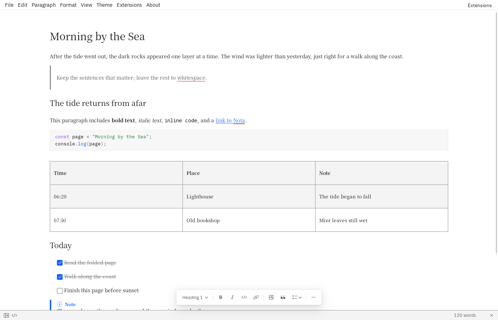
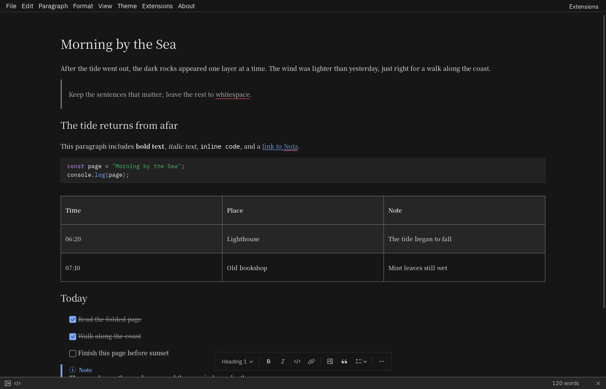
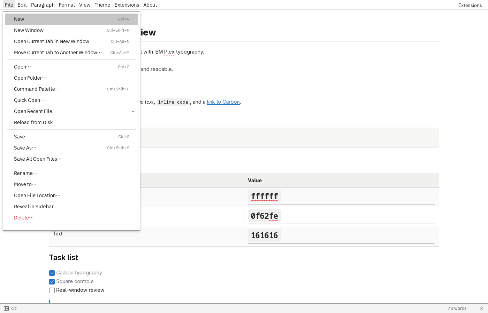

# Carbon-inspired interface theme

This theme translates IBM Carbon's productive visual language into Nota's
interface variables. It follows Carbon's current white and g100 theme tokens
rather than applying a generic square-corner treatment.

The implementation includes:

- Carbon's gray ladder and blue focus/selection tokens
- the dark Gray100/Gray90/Gray80 hierarchy (#161616/#262626/#393939) and
  interactive blue (#0062ff)
- the black UI Shell header used by IBM product interfaces
- 14px body typography with 0.16px tracking
- Carbon contained tabs with a two-pixel active indicator
- data-table rows, subtle borders and three-pixel selected markers
- square controls, Carbon focus outlines and compact toggle proportions
- IBM Plex Sans SC and IBM Plex Mono bundled offline

Reference sources are the Carbon design system documentation and the
`@carbon/themes`, `@carbon/type`, `@carbon/styles`,
`@carbon/web-components` packages in `carbon-design-system/carbon`.

The package is independent and is not affiliated with or endorsed by IBM.

## Install

1. Open Nota and choose **Settings -> Appearance -> Styles folder...**.
2. Copy this directory, including `assets/`, into that folder.
3. Select **carbon** under **Interface style**.

## Licensing

- Carbon Icons: Apache License 2.0. The full text is in
  `assets/icons-theme/LICENSE-APACHE-2.0.txt`.
- IBM Plex Sans SC and IBM Plex Mono: SIL Open Font License 1.1. The full texts
  are in `assets/fonts/`.

The assets are bundled with this theme package, not with the Nota application.
